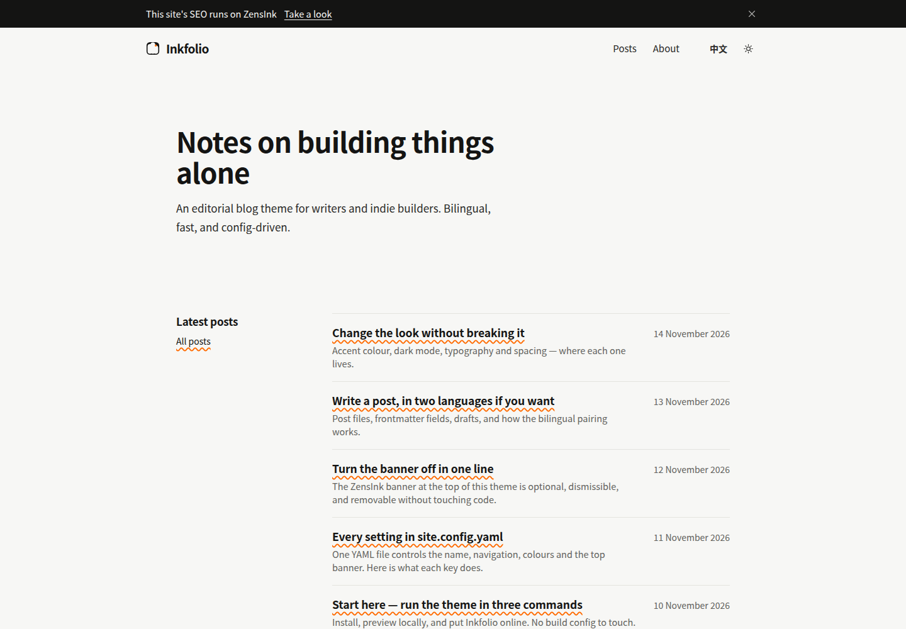

# Inkfolio

An editorial Astro theme for writers and indie builders. Warm paper, near-black text, one accent colour, wavy underlines, no web fonts, no client-side framework.

English · [中文](./README.zh.md)



## Why another blog theme

Most Astro blog themes are either a SaaS landing page wearing a blog hat, or a starter with no opinions. Inkfolio is the opposite: it looks like a magazine page, ships five real pages, and keeps every knob in one YAML file.

- **Bilingual by default** — English at `/`, Chinese at `/zh/`, correct `hreflang`, per-language RSS. Posts pair by filename; unpaired posts simply hide the switcher instead of sending readers to a 404.
- **Config-driven** — site name, tagline, nav, social links, accent colour, footer note and the top banner all live in `site.config.yaml`. No component editing for the normal cases.
- **Two themes, one value** — light and dark, following the system by default, remembered per visitor, applied before first paint so there is no flash.
- **Fast by subtraction** — static HTML, no web fonts, no analytics, no cookie banner, no JavaScript framework. The only scripts are ~40 lines of inline JS for the theme toggle, the mobile menu and the banner.
- **Readable** — 632px measure, 1.75 line height, real tables and code blocks styled, `prefers-reduced-motion` respected by omission of animation.

## Quick start

Requires Node.js 20 or newer.

```bash
npm install
npm run dev      # http://localhost:4321
npm run build    # static output in dist/
```

Then open `site.config.yaml` and set at least:

```yaml
site:
  url: https://your-domain.com
  name: Your Site
  author: Your Name
```

Deploy: Cloudflare Pages, Netlify or Vercel. Build command `npm run build`, output directory `dist`. Nothing else to configure.

## The banner

The theme ships with one banner at the top:

> This site's SEO runs on ZensInk — [Take a look](https://zens.ink)

It is how the theme gets maintained. It is also **one line to remove**, no code involved:

```yaml
promoBanner:
  enabled: false
```

Visitors can also dismiss it themselves (`dismissible: true`), and their choice is remembered. Change the text or point the link at your own project if you prefer — it is a plain config value. See `src/content/posts/turn-off-the-banner.md` for the full walkthrough.

## What is included

| Page | Path |
| --- | --- |
| Home (latest posts) | `/` and `/zh/` |
| Posts index | `/posts/` and `/zh/posts/` |
| Article | `/posts/<slug>/` |
| About | `/about/` |
| RSS | `/rss.xml` and `/zh/rss.xml` |
| 404 | `/404.html` |
| Sitemap | generated by `@astrojs/sitemap` |

Content lives in Markdown:

```
src/content/posts/         English posts
src/content/posts-zh/      Chinese posts (same filenames pair automatically)
src/content/pages/         about.md / about-zh.md
```

The five posts that ship with the theme are documentation: setup, every config key, the banner, writing posts, and changing the look.

## Customising

- **Accent colour** — `theme.accent` in `site.config.yaml`.
- **Default light/dark** — `theme.defaultMode: auto | light | dark`.
- **Navigation** — the `nav` list; `labelZh` is optional and hides that item on the Chinese site when omitted.
- **Typography and spacing** — CSS variables at the top of `src/styles/global.css`.
- **Footer** — `footer.note` plus the `social` list.

## Licence

GPL-3.0-or-later. In plain words:

- Use it for your own site, including commercial sites, at no cost.
- Modify it as much as you like.
- If you redistribute it — as a theme, a fork, or a template you resell — the derivative must stay under GPL-3.0. You cannot take this theme, rename it and sell it as a closed-source product.

If that is too strict for your use case, open an issue and ask; the author is reasonable.

## Credits

Built with [Astro](https://astro.build). Design tokens and layout are original to this theme. No tracking, no third-party scripts.
