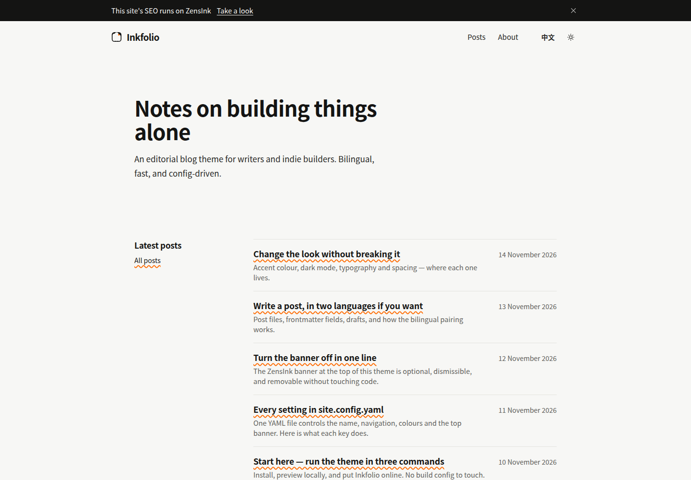

# Inkfolio

给写作者与独立开发者的编辑风 Astro 博客主题。暖纸白、近黑正文、一个强调色、波浪下划线、零 webfont、不带前端框架。

[English](./README.md) · 中文



## 为什么又一个博客主题

Astro 的博客主题大多两极化：要么是套着博客外壳的 SaaS 落地页，要么是完全没有主张的脚手架。Inkfolio 反过来——看起来像一页杂志，只有五个真实页面，所有开关收在一个 YAML 文件里。

- **默认可双语**：英文在 `/`，中文在 `/zh/`，`hreflang` 正确，每种语言一份 RSS。文章按文件名配对；没有对应译文的文章直接不显示切换按钮，而不是把读者送到 404。
- **配置驱动**：站名、标语、导航、社交链接、强调色、页脚小字、顶部横幅，全在 `site.config.yaml`。常规改动不用打开任何组件。
- **一次设置两种主题**：亮色与暗色，默认跟随系统，按访客记忆，且在首次绘制前应用，不会闪。
- **靠减法变快**：纯静态、零 webfont、无统计脚本、无 cookie 弹窗、无前端框架。全站脚本就是约 40 行内联 JS：主题切换、移动菜单、横幅。
- **能读**：正文 632px、行高 1.75，表格和代码块有正经样式；不加动画，天然尊重「减少动态效果」的系统设置。

## 快速开始

需要 Node.js 20 或更新版本。

```bash
npm install
npm run dev      # http://localhost:4321
npm run build    # 输出到 dist/
```

然后打开 `site.config.yaml`，至少改这三行：

```yaml
site:
  url: https://your-domain.com
  name: 你的站名
  author: 你的名字
```

部署：Cloudflare Pages、Netlify、Vercel 都行。构建命令 `npm run build`，输出目录 `dist`，没有别的配置。

## 关于顶部横幅

主题自带一条横幅：

> 本站的 SEO 用 ZensInk 跑 — [去看看](https://zens.ink)

这是它持续维护的方式，同时也是**一行就能关掉**的东西，不用改代码：

```yaml
promoBanner:
  enabled: false
```

访客也可以自己关（`dismissible: true`），选择会被记住。想换文案、把链接指向你自己的项目都行——它就是个普通配置项。完整说明见 `src/content/posts-zh/turn-off-the-banner.md`。

## 包含哪些页面

| 页面 | 路径 |
| --- | --- |
| 首页（最新文章） | `/` 与 `/zh/` |
| 文章索引 | `/posts/` 与 `/zh/posts/` |
| 正文 | `/posts/<slug>/` |
| 关于 | `/about/` |
| RSS | `/rss.xml` 与 `/zh/rss.xml` |
| 404 | `/404.html` |
| sitemap | 由 `@astrojs/sitemap` 生成 |

内容都是 Markdown：

```
src/content/posts/         英文文章
src/content/posts-zh/      中文文章（同名自动配对）
src/content/pages/         about.md / about-zh.md
```

主题自带五篇文章即文档：上手、每个配置项、横幅、写文章、改外观。

## 怎么改

- **强调色**：`site.config.yaml` 的 `theme.accent`。
- **默认亮/暗**：`theme.defaultMode: auto | light | dark`。
- **导航**：`nav` 列表；`labelZh` 可选，不写就不出现在中文站。
- **字体与间距**：`src/styles/global.css` 顶部的 CSS 变量。
- **页脚**：`footer.note` 与 `social` 列表。

## 许可证

GPL-3.0-or-later。说人话：

- 自己用，包括商业站点，免费。
- 想怎么改都行。
- 二次分发——不管是发主题、发分支，还是打包成模板卖——衍生作品必须继续用 GPL-3.0。不能拿这个主题改个名当闭源产品卖。

如果这个条件对你的用法太严，开个 issue 问一声，作者挺好说话。

## 致谢

用 [Astro](https://astro.build) 构建。设计令牌与布局为本主题原创。无埋点、无第三方脚本。
